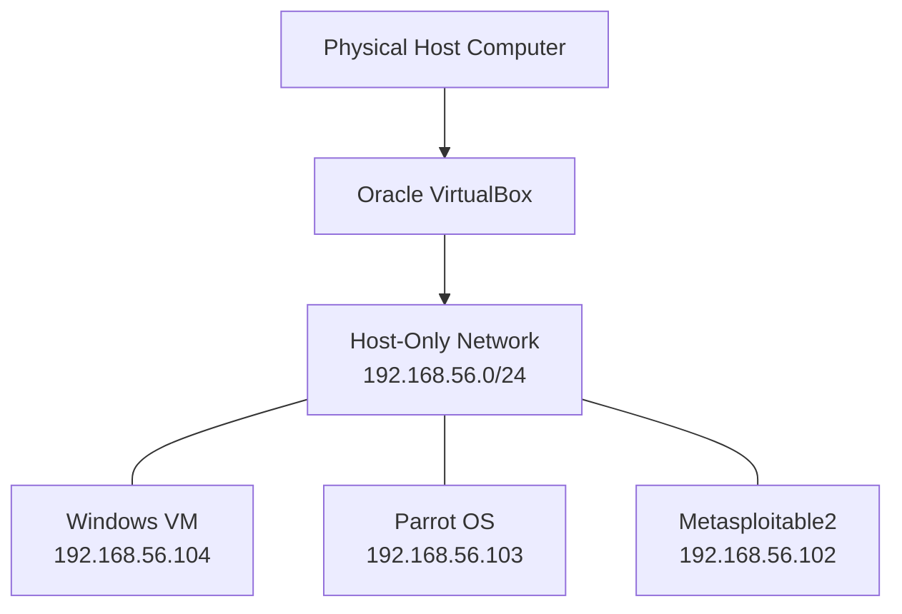

# Project 01: Network Topology

## Network Topology Diagram

### IP Addressing

| Machine| IPv4 Address| Purpose |
| :--|:--|:--|
| Windows| 192.168.56.104/24| Client and connectivity testing |
| Parrot OS| 192.168.56.103/24| Security testing machine |
| Metasploitable2| 192.168.56.102/24| Intentionally vulnerable target |

# Connectivity Validation

- Windows to Parrot OS: Successful
- Windows to Metasploitable2: Successful
- Parrot OS to Metasploitable2: Successful, 0% packet loss

# Network Design Notes

All three machines have been tested for connectivity on the "192.168.56.0/24" lab network. The diagram represents the tested logical connectivity. Confirm each VM's VirtualBox adapter configuration before treating the diagram as a verified physical or virtual adapter layout.
